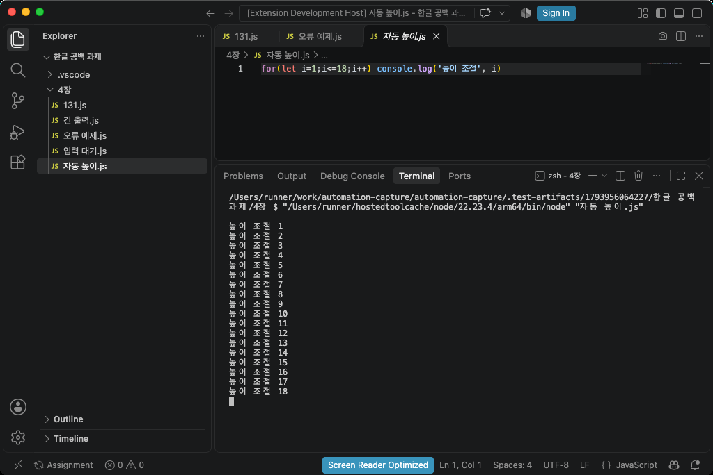
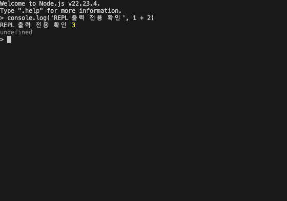

# Mac 버전 · JS Assignment AutoCapture 0.6.0

macOS의 실제 zsh에서 JavaScript를 실행하고 VS Code 화면을 제출용 이미지로 저장합니다. **Apple Silicon과 Intel 설치 파일을 구분합니다.**

[전체 기능·기술 스택](README.md) · [Windows 버전](README.windows.md) · [검증 기록](TESTING.md)

## 내 Mac에 맞는 파일

| Mac 종류 | VSIX 설치 파일 | Actions 산출물 |
|---|---|---|
| Apple Silicon · M 시리즈 | `js-assignment-autocapture-0.6.0-darwin-arm64.vsix` | `autocapture-darwin-arm64` |
| Intel | `js-assignment-autocapture-0.6.0-darwin-x64.vsix` | `autocapture-darwin-x64` |

**Apple 메뉴 → 이 Mac에 관하여**에서 칩 또는 프로세서를 확인합니다. macOS 13 이상과 VS Code 데스크톱 1.100 이상을 대상으로 하며 실제 CI 운영체제와 결과는 [검증 표](README.md#검증-상태)에 기록합니다.

VS Code 자체를 Intel/Rosetta 버전으로 실행한다면 확장도 VS Code 아키텍처에 맞는 Intel용을 사용하세요.

## 필요한 프로그램

Node.js 22 이상과 Python 3.10 이상을 설치합니다. [Node.js](https://nodejs.org/en/download), [Python macOS 설치 파일](https://www.python.org/downloads/macos/), [VS Code](https://code.visualstudio.com/download)을 사용할 수 있습니다. Homebrew Python도 가상 환경을 통해 사용할 수 있습니다.

```sh
node --version
python3 --version
```

## 설치

```sh
git clone https://github.com/Blaze828/automation-capture.git
cd automation-capture
npm ci
python3 -m venv .venv
./.venv/bin/python -m pip install -r python/requirements.txt
npm run package:mac
```

`dist/`에 Apple Silicon용과 Intel용 VSIX 두 개가 생깁니다. VS Code에서 **확장 → ⋯ → VSIX에서 설치…**를 선택하고 내 Mac에 맞는 파일 하나를 설치하세요. [Actions](https://github.com/Blaze828/automation-capture/actions) 산출물을 받았다면 빌드는 생략할 수 있지만 Python 패키지는 설치해야 합니다.

**Command+Shift+P → Preferences: Open User Settings (JSON)**에서 가상 환경의 Python 절대 경로를 지정합니다.

```json
{
  "assignment.pythonPath": "/Users/사용자명/automation-capture/.venv/bin/python",
  "assignment.nodePath": "node"
}
```

`pwd`로 실제 저장소 위치를 확인하고 경로를 바꾸세요. 저장소나 가상 환경을 옮기면 설정도 바꿔야 합니다. `node`를 찾지 못하면 `command -v node`의 실제 출력 경로를 `assignment.nodePath`에 지정하세요. Apple Silicon Homebrew는 `/opt/homebrew/bin/node`, Intel은 `/usr/local/bin/node`일 수 있습니다.

## macOS 권한

- **시스템 설정 → 개인정보 보호 및 보안 → 화면 및 시스템 오디오 기록**: 실제 창 촬영에 필요합니다. 버전에 따라 **화면 기록**으로 표시됩니다.
- **시스템 설정 → 개인정보 보호 및 보안 → 손쉬운 사용**: 터미널 영역 확인과 높이 조절에 필요합니다.

권한 요청에 표시된 앱(VS Code 또는 Python)을 허용합니다. 화면 기록 권한을 바꾸면 **VS Code를 완전히 종료한 뒤 다시 열어야** 합니다. 확장은 운영체제 권한을 자동으로 변경하지 않습니다. [Apple 화면 기록 권한 안내](https://support.apple.com/guide/mac-help/control-access-screen-system-audio-recording-mchld6aa7d23/mac)

CI의 실행·API 검증과 실제 화면 촬영 검증은 구분합니다. 화면 기록·손쉬운 사용이 허용되지 않은 환경에서는 GUI 캡처를 검증 완료로 표시하지 않습니다.

## 실행·캡처

1. 평소 JS 과제 폴더를 VS Code에서 열고 `.js` 파일을 선택합니다.
2. 터미널을 원하는 위치와 높이로 배치합니다.
3. **Control+Option+Q (`⌃⌥Q`)** 또는 편집기 카메라 버튼을 누릅니다.
4. 처음 표시되는 제출 폴더와 PNG/JPG/WebP 형식을 선택합니다.
5. 실행 결과와 JS 원본이 제출 폴더에 저장됩니다.

자동 실행용 **zsh 하나를 재사용**합니다. 파일을 바꾸면 이전 출력과 스크롤 기록을 비우고 새 결과를 맨 위부터 표시합니다. 캡처 후에는 같은 zsh 프롬프트로 돌아옵니다. 사용자의 셸 플러그인·별칭 영향을 줄이기 위해 자동 실행용 zsh는 `-f`로 시작합니다.

일반 캡처는 탐색기와 파일 탭을 포함합니다. 출력이 현재 크기에 들어가면 배치를 유지하고 넘칠 때만 한 번 높이를 조절합니다. 더 늘릴 수 없으면 출력만 분할합니다. Retina 화면의 논리 좌표는 실제 이미지 픽셀 배율로 변환합니다.

## 단축키

Mac의 **Control은 ⌃, Option은 ⌥**입니다. Command(⌘) 키와 구분하세요.

| 기능 | 키 |
|---|---|
| 실행·자동 캡처 | Control+Option+Q |
| 현재 창 추가 캡처 | Control+Option+W |
| Node REPL 시작 | Control+Option+E |
| REPL 출력만 캡처 | Control+Option+D |
| 실행 중단 | Control+Option+X |
| PNG/JPG/WebP 선택 | Control+Option+F |
| 수동 분할 캡처 | Control+Option+A |

명령 팔레트는 **Command+Shift+P**입니다. VoiceOver나 다른 확장과 충돌하면 Keyboard Shortcuts에서 변경하세요. ZIP은 **Assignment: Export Chapter ZIP**에서 만듭니다.

REPL에서 JavaScript를 입력한 뒤 **Control+Option+D**를 누르면 현재 보이는 출력 영역만 저장합니다. 코드 영역은 포함하지 않고 REPL 세션도 유지합니다. 긴 기록은 스크롤한 뒤 필요한 화면을 추가로 저장하세요.

## 문제 해결·제한

| 증상 | 확인할 내용 |
|---|---|
| PyObjC/Pillow 모듈 오류 | 설정한 `assignment.pythonPath`와 패키지를 설치한 가상 환경이 같은지 확인 |
| 화면 기록/손쉬운 사용 오류 | 권한 허용, VS Code 완전히 종료 후 다시 열기 |
| 터미널 접근성 영역을 찾지 못함 | 터미널 선택 후 재시도. 필요하면 `code --force-renderer-accessibility`로 시작 |
| 파일명 불일치 | JS 탭 선택, `window.title`의 `${activeEditorShort}` 확인 |
| 단축키 충돌 | 명령 팔레트에서 Assignment 명령 실행 또는 키 변경 |

접근성 트리에 경계선이 노출되지 않으면 일반 실행은 배치를 유지하고 출력 분할로 진행합니다. REPL 영역을 확인하지 못하면 오류를 표시하며 코드가 포함된 전체 창을 대신 저장하지 않습니다. 실제 GUI·드래그·다중 모니터의 검증 범위는 [TESTING.md](TESTING.md)를 확인하세요.

Mac 창 검증에는 AppKit/Quartz의 전면 앱 PID와 CGWindowID, 촬영에는 시스템 `screencapture`, 측정에는 ApplicationServices AX를 사용합니다. Python 기본 명령은 `python3`이며 사용자 지정 경로가 있으면 그 경로를 우선합니다.

## 검증 화면

2026-11-06 [Apple Silicon·Intel Mac CI](https://github.com/Blaze828/automation-capture/actions/runs/42192492596)가 모두 성공했습니다. 각각 Node 단위 검사 18개와 Python 검사 23개, VS Code 확장 API 통합 검사, 실제 GUI 캡처 검사를 통과했습니다. VS Code 1.145.1, Node.js 22, Python 3.13에서 확인했습니다.

아래는 Apple Silicon 러너에서 실제 VS Code 창을 촬영한 결과입니다. 18줄 출력 전체와 아래 여백을 한 장에 담고, 탐색기의 선택 파일과 활성 파일 탭을 함께 표시합니다.



REPL 캡처에는 출력 영역만 들어갑니다. 코드와 탐색기 영역은 포함하지 않으며, 캡처 뒤에도 REPL 세션이 살아 있는 것을 검사했습니다.



PNG/JPG/WebP 저장, 추가 캡처, 긴 출력 분할, 긴 코드·짧은 출력의 한 장 저장, 반복 출력 대표 화면도 두 Mac에서 통과했습니다. Retina 좌표 변환은 단위 검사로 확인했으며, 실제 Retina 화면과 혼합 배율 다중 모니터는 별도 확인 대상입니다.
