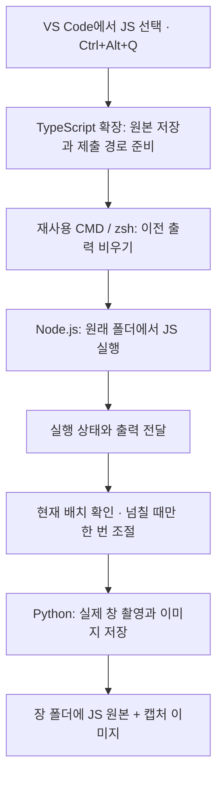

# JS Assignment AutoCapture

**JavaScript 파일을 실행하고, 실제 VS Code 화면을 과제 제출용 이미지로 저장하는 Windows·macOS용 VS Code 확장 프로그램입니다.**

JS 파일을 선택하고 `Ctrl+Alt+Q`를 누르면 **터미널 실행 → 결과 확인 → 화면 캡처 → JS 원본과 이미지 저장**이 자동으로 이어집니다. 캡처에는 왼쪽 탐색기에서 선택한 파일과 위쪽 파일 탭을 함께 남겨, 어떤 파일의 실행 결과인지 확인할 수 있습니다.

현재 버전은 **0.6.0**입니다. 코드를 자동으로 작성하거나 수정하지 않으며, 사용자가 작성한 원본 JS를 저장한 뒤 실행합니다.

## 주요 기능

- **터미널 하나 재사용**: 파일을 바꿔 실행해도 Windows에서는 CMD, Mac에서는 zsh 하나를 계속 사용합니다. 실행 전 이전 화면과 스크롤 기록을 비워 현재 파일의 명령과 결과부터 표시합니다.
- **실행 후 자동 캡처**: 실행 종료를 감지해 실제 VS Code 창을 촬영합니다. 출력에 `[실행 완료 · 종료 코드: 0]` 같은 문구를 덧붙이지 않습니다.
- **사용자 화면 배치 유지**: 출력이 들어가면 터미널 위치와 크기를 그대로 둡니다. 잘릴 때만 필요한 높이로 한 번 조절하며, 출력 아래에는 2~5줄 정도의 여백을 둡니다.
- **필요할 때만 출력 분할**: 한 번 조절해도 출력이 길면 여러 장으로 저장합니다. 코드 파일이 길다는 이유로 자동 분할하지 않습니다.
- **이미지 형식 선택**: PNG, JPG, WebP 중에서 선택하고 다음 캡처에도 같은 형식을 사용합니다.
- **REPL 캡처**: Node.js 대화형 실행을 지원하며, REPL은 현재 터미널 출력 영역만 저장합니다.
- **장별 제출 정리**: JS 원본과 캡처를 장 폴더에 모으고 ZIP으로 압축할 수 있습니다.

## 설치하기

### Windows 설치

#### 1. 실행 환경 준비

| 항목 | 필요한 환경 | 다운로드 |
|---|---|---|
| 운영체제 | Windows 10/11 또는 macOS 13 이상, 로컬 데스크톱 | — |
| Visual Studio Code | 1.100 이상, Windows/macOS 데스크톱 버전 | [VS Code 다운로드](https://code.visualstudio.com/download) |
| Node.js | 22 이상 | [Node.js 다운로드](https://nodejs.org/en/download) |
| Python | 3.10 이상, 3.13에서 검증 | [Python 다운로드](https://www.python.org/downloads/) |
| Git | 아래 `git clone` 방식으로 설치할 때 필요 | [Git 다운로드](https://git-scm.com/downloads) |

설치 후 PowerShell 또는 CMD를 새로 열어 확인합니다.

```powershell
code --version
node --version
python --version
```

#### 2. 소스 내려받기와 의존성 설치

아래 명령은 **프로젝트를 설치하는 단계에서 한 번** 실행합니다.

```powershell
git clone https://github.com/Blaze828/automation-capture.git
cd automation-capture
npm ci
python -m pip install -r python/requirements.txt
```

Git을 사용하지 않는다면 GitHub의 **Code → Download ZIP**으로 소스를 내려받아 압축을 풀고, 그 폴더에서 마지막 두 명령을 실행해도 됩니다.

#### 3. VSIX 설치 파일 만들기

프로젝트 폴더에서 실행합니다.

```powershell
npm run package
```

현재 버전 기준으로 `js-assignment-autocapture-0.6.0.vsix`가 생성됩니다. 빌드 과정에서 TypeScript도 함께 컴파일됩니다.

#### 4. VS Code에 설치

```powershell
code --install-extension .\js-assignment-autocapture-0.6.0.vsix --force
```

마우스로 설치하려면 다음 순서를 사용합니다.

1. VS Code에서 **확장** 패널을 엽니다. 단축키는 `Ctrl+Shift+X`입니다.
2. 패널 위쪽 **⋯ → VSIX에서 설치…**를 선택합니다.
3. 생성한 `.vsix` 파일을 선택합니다.
4. 설치 후 VS Code를 다시 열거나, `Ctrl+Shift+P`에서 **개발자: 창 다시 로드**를 실행합니다.

이미 VSIX 파일을 받았다면 직접 빌드하는 단계는 생략할 수 있습니다. **Node.js, Python, `python/requirements.txt`의 Python 패키지는 별도로 필요**합니다. GitHub Actions 빌드가 성공하면 [Actions](https://github.com/Blaze828/automation-capture/actions)의 해당 실행 페이지에서 `js-assignment-autocapture-vsix` 산출물도 받을 수 있습니다.

확장을 설치한 뒤에는 매번 이 저장소를 열거나 F5를 누를 필요가 없습니다. **평소 사용하는 JavaScript 과제 폴더를 VS Code에서 열어 사용하면 됩니다.**

### Mac 설치 (Apple Silicon·Intel 공통)

Node.js 22 이상, Python 3.10 이상, VS Code 데스크톱 버전을 설치한 뒤 macOS 터미널에서 실행합니다. Python은 [python.org](https://www.python.org/downloads/macos/) 또는 Homebrew로 설치할 수 있습니다. 가상 환경을 사용하므로 시스템 Python의 패키지 설치 제한을 변경할 필요가 없습니다.

```sh
git clone https://github.com/Blaze828/automation-capture.git
cd automation-capture
npm ci
python3 -m venv .venv
./.venv/bin/python -m pip install -r python/requirements.txt
npm run package
```

VS Code에서 **확장 → ⋯ → VSIX에서 설치…**를 선택하고 `js-assignment-autocapture-0.6.0.vsix`를 설치합니다. 명령 팔레트에서 **Preferences: Open User Settings (JSON)**을 열고, 위에서 만든 가상 환경의 Python을 절대 경로로 지정합니다.

```json
{
  "assignment.pythonPath": "/Users/사용자명/automation-capture/.venv/bin/python"
}
```

`pwd`로 실제 저장소 경로를 확인하세요. 저장소나 가상 환경을 옮기면 설정 경로도 바꿔야 합니다. `node`를 찾지 못하면 `command -v node`로 확인한 경로를 `assignment.nodePath`에 지정합니다. 예를 들어 Apple Silicon Homebrew 설치는 `/opt/homebrew/bin/node`, Intel은 `/usr/local/bin/node`일 수 있습니다. 터미널 명령의 실제 결과를 사용하세요.

첫 캡처 때 macOS가 요청하는 권한을 허용합니다.

- **시스템 설정 → 개인정보 보호 및 보안 → 화면 및 시스템 오디오 기록**: 실제 창 촬영에 필요합니다. macOS 버전에 따라 **화면 기록**으로 표시됩니다.
- **시스템 설정 → 개인정보 보호 및 보안 → 손쉬운 사용**: 넘치는 터미널의 높이 조절과 REPL 영역 확인에 필요합니다.

권한 요청에 표시된 앱(VS Code 또는 Python)을 허용하세요. 화면 기록 권한을 바꾼 뒤에는 VS Code를 완전히 종료하고 다시 엽니다. 운영체제 권한은 확장이 자동으로 변경하지 않습니다. [Apple 화면 기록 권한 안내](https://support.apple.com/guide/mac-help/control-access-screen-system-audio-recording-mchld6aa7d23/mac)

Mac 단축키는 **Control+Option+Q/W/E/D/X/F/A (`⌃⌥`)**입니다. 아래 표의 `Ctrl+Alt`를 `Control+Option`으로 읽으면 됩니다. 명령 팔레트는 **Command+Shift+P**로 엽니다. VoiceOver 등과 키가 겹치면 VS Code의 Keyboard Shortcuts에서 변경할 수 있습니다.

Mac에서도 동일한 zsh 터미널에서 이전 출력과 스크롤 기록을 비우고 실행하며, 캡처 뒤에는 zsh 프롬프트로 돌아옵니다. 사용자의 `.zshrc` 플러그인이나 별칭이 자동 실행을 방해하지 않도록 자동 실행용 zsh는 `-f` 옵션으로 시작합니다. 일반 실행 캡처는 탐색기·파일 탭을 포함하고, REPL 캡처는 터미널 출력 영역만 잘라 저장합니다. Retina 화면의 좌표도 이미지 픽셀 배율로 변환합니다.

## 사용하기

### 기본 실행과 자동 캡처

1. VS Code에서 과제 폴더를 열고, 실행할 `.js` 파일을 선택합니다.
2. 터미널을 원하는 위치와 높이로 배치합니다.
3. **`Ctrl+Alt+Q`**를 누릅니다. 편집기 오른쪽 위 **카메라 버튼**이나 왼쪽 아래 **Assignment**를 눌러도 됩니다.
4. 처음에는 **제출 결과를 저장할 폴더**와 **이미지 형식**을 선택합니다.
5. 자동 실행용 터미널(Windows CMD / Mac zsh)에서 JS가 실행되고, 결과 화면과 JS 원본이 저장됩니다.

예를 들어 `6장/test.js`를 실행한 뒤 `5장/166.js`를 실행하면 다음과 같이 동작합니다.

```text
같은 터미널 재사용
  → 이전 출력과 스크롤 기록 비우기
  → 새 파일이 있는 폴더에서 실행
  → 현재 파일의 명령과 결과를 맨 위부터 표시
  → 화면 캡처와 제출 파일 저장
```

캡처가 끝나면 해당 셸의 프롬프트로 돌아옵니다. 자동 실행용 터미널을 닫으면 다음 실행 때 새로 만들며, 다른 사용자 터미널을 이름만 보고 선택하지 않습니다. 그 터미널에서 다른 프로그램을 실행 중이라면 해당 프로그램을 끝낸 뒤 자동 실행을 사용하세요.

캡처할 때까지 VS Code 창을 전면에 두고 다른 창이 가리지 않게 해 주세요. 코드에 오류가 있으면 Node.js의 오류 출력 화면도 저장합니다.

### 터미널 높이와 긴 출력

- **현재 크기에서 출력이 들어가는 경우**: 크기를 바꾸지 않고 캡처합니다.
- **출력이 잘리는 경우**: 현재 터미널의 실제 경계와 글자 높이로 최종 높이를 계산해 **한 번만** 조절합니다. 아래 여백은 출력 길이의 약 12%, 최소 2줄~최대 5줄을 기준으로 합니다.
- **더 늘릴 수 없거나, 높이 조절이 어려운 좌우 배치인 경우**: 터미널을 다른 위치로 옮기지 않고 출력만 분할합니다.

크기를 알아내려고 최대화와 축소를 반복하지 않으며, 이미 넓게 배치한 터미널을 짧은 출력에 맞춰 자동으로 줄이지도 않습니다. 일반 실행 캡처는 JS 원본을 별도 제출하므로 코드 전체가 사진에 들어갈 필요는 없습니다.

### 이미 실행한 터미널 화면 캡처

VS Code 안의 CMD나 zsh에서 직접 `node test.js`를 실행했다면, 대상 JS 탭을 열어 둔 상태에서 **`Ctrl+Alt+W`**를 누르세요. 재실행이나 자동 크기 조절 없이 현재 VS Code 화면을 추가 저장합니다.

### 이미지 형식 변경

**`Ctrl+Alt+F`**를 누르고 형식을 선택합니다.

| 형식 | 저장 방식 |
|---|---|
| PNG | 무손실 이미지 |
| JPG | 품질 95로 압축한 이미지 |
| WebP | 무손실 압축 이미지 |

선택한 형식은 다음 실행, 추가 캡처, REPL 캡처에도 적용됩니다.

### REPL 사용

1. 기준이 될 JS 파일을 선택하고 **`Ctrl+Alt+E`**를 누릅니다.
2. 열린 Node.js REPL에 `1 + 2`처럼 확인할 JavaScript를 직접 입력합니다.
3. **`Ctrl+Alt+D`**를 누르면 **현재 보이는 REPL 출력 영역만** 저장합니다.

REPL 캡처는 터미널의 위치와 크기를 바꾸거나 세션을 초기화하지 않습니다. 같은 폴더에서 REPL 시작 명령을 다시 호출하면 기존 세션을 재사용합니다. 긴 REPL 기록은 직접 스크롤한 뒤 필요한 화면을 추가 캡처하세요.

### 수동 분할과 ZIP 만들기

- **`Ctrl+Alt+A`**: 코드, 실행 결과, 둘 다 중에서 선택해 수동으로 분할 캡처합니다. JS를 다시 실행하지 않습니다. 출력 분할은 이 확장으로 실행하여 보관한 같은 파일의 결과에 적용됩니다.
- **`Ctrl+Shift+P` → `Assignment: Export Chapter ZIP`**: 제출 폴더에서 장을 선택하면 해당 장의 JS와 캡처 이미지를 ZIP으로 묶습니다. 하위 폴더와 다른 파일은 포함하지 않습니다.

## 단축키와 명령

단축키는 왼손으로 누르기 쉽도록 키보드 왼쪽 문자 키에 배치했습니다. 단축키가 다른 확장과 겹치면 `Ctrl+Shift+P`에서 아래 명령 이름을 검색하거나, VS Code의 바로 가기 키 설정에서 변경할 수 있습니다.

| 기능 | 단축키 | 명령 팔레트에서 검색할 이름 |
|---|---|---|
| 실행 후 자동 캡처 | **Ctrl+Alt+Q** | `Assignment: Run and Capture` |
| 현재 화면 추가 캡처 | **Ctrl+Alt+W** | `Assignment: Capture Again` |
| REPL 시작 | **Ctrl+Alt+E** | `Assignment: Start REPL` |
| REPL 출력 캡처 | **Ctrl+Alt+D** | `Assignment: Capture REPL` |
| 실행 중단 | **Ctrl+Alt+X** | `Assignment: Stop Run` |
| 이미지 형식 선택 | **Ctrl+Alt+F** | `Assignment: Select Image Format` |
| 수동 분할 캡처 | **Ctrl+Alt+A** | `Assignment: Capture Multiple Pages` |
| 저장 폴더 선택 | — | `Assignment: Select Output Folder` |
| 저장 폴더 열기 | — | `Assignment: Open Output Folder` |
| 장별 ZIP 생성 | — | `Assignment: Export Chapter ZIP` |

## 저장되는 파일

원본이 `C:/JavaScript/6장/test.js`이고 제출 폴더를 `C:/제출`로 선택했다면 다음처럼 저장됩니다. 아래는 PNG를 선택한 예시입니다.

```text
제출/
└─ 6장/
   ├─ test.js
   ├─ test 실행결과.png
   ├─ test 실행결과_02.png
   └─ test REPL.png
```

- 장 이름은 **원본 JS가 들어 있는 부모 폴더 이름**을 사용합니다.
- 원본 파일을 원래 폴더에서 실행하므로 상대 경로 모듈과 데이터 파일을 참조할 수 있습니다.
- 제출 폴더에는 JS 원본과 캡처 이미지만 복사합니다. 의존 파일까지 포함한 독립 실행 패키지는 아닙니다.
- 같은 이름이 있으면 덮어쓰기, 새 버전 저장, 취소 중에서 선택합니다. 추가 캡처에는 `_02`, `_03` 등의 번호가 붙습니다.
- 캡처에 실패해도 이미 저장한 JS는 남습니다. 성공 알림은 이미지 저장이 끝난 뒤 표시합니다.

## 설정

VS Code 설정에서 `assignment`를 검색하거나 `settings.json`에 지정합니다.

| 설정 | 기본값 | 설명 |
|---|---|---|
| `assignment.outputFolder` | 빈 문자열 | 제출 결과를 저장할 폴더의 절대 경로. 비어 있으면 처음 사용할 때 선택 |
| `assignment.imageFormat` | 빈 문자열 | `png`, `jpg`, `webp`. 비어 있으면 처음 캡처할 때 선택 |
| `assignment.nodePath` | `node` | Node.js 실행 파일 경로 |
| `assignment.pythonPath` | 빈 값: Windows `python`, Mac `python3` | 캡처용 패키지를 설치한 Python 실행 파일 경로 |
| `assignment.timeoutSeconds` | `30` | 실행 제한 시간(초) |
| `assignment.captureDelayMs` | `800` | 촬영 전 화면이 안정될 때까지 기다리는 시간(ms) |

설정 예시:

```json
{
  "assignment.outputFolder": "C:/Assignments/제출",
  "assignment.imageFormat": "png",
  "assignment.nodePath": "node",
  "assignment.pythonPath": "",
  "assignment.timeoutSeconds": 30,
  "assignment.captureDelayMs": 800
}
```

Node/Python 경로에는 실행 파일만 지정하고 인수는 넣지 않습니다. Python이 여러 개라면 `assignment.pythonPath`에 실제 Python 실행 파일(가상 환경 포함) 경로를 지정하고, **같은 실행 파일로** 패키지를 설치해야 합니다.

## 기술 스택

| 영역 | 기술 | 역할 |
|---|---|---|
| VS Code 확장 | **TypeScript, VS Code Extension API** | 명령·단축키 등록, 파일 선택과 저장, 탐색기·탭 표시, 터미널 제어 |
| JavaScript 실행 | **Node.js, `child_process`, CMD / zsh** | 원본 폴더에서 JS 실행, 표준 출력/오류 수집, 실행 중단 |
| 실행 상태 전달 | **JavaScript(CommonJS), 임시 JSON·텍스트 파일** | 실제 CMD에서 실행 상태와 출력을 확장에 전달하고, 같은 터미널 재사용 |
| 화면 캡처 | **Python, mss, PyGetWindow** | 대상 VS Code 창을 확인하고 실제 화면을 이미지로 저장 |
| macOS 창 제어·캡처 | **PyObjC, AppKit, Quartz, ApplicationServices, screencapture** | CGWindowID/PID 확인, 실제 창 촬영, AX 영역 측정과 한 번의 경계선 이동 |
| Windows 창 제어 | **ctypes, Win32 API, DWM** | HWND/PID 확인, 창 경계·전면 상태·DPI 처리 |
| 터미널 영역 측정 | **comtypes, Windows UI Automation** | 터미널과 경계선 위치 측정, 한 번의 크기 조절, REPL 캡처 영역 선택 |
| 이미지 인코딩 | **Pillow** | JPG 및 WebP 저장 |
| ZIP 생성 | **archiver** | 장별 JS와 캡처 이미지 압축 |
| 빌드·배포 파일 | **TypeScript Compiler, @vscode/vsce** | TypeScript 컴파일 및 VSIX 패키징 |
| 테스트·CI | **node:test, Python unittest, GitHub Actions** | 실행·파일·이미지·배치 검사와 Windows/macOS 빌드 |

### 동작 구조



캡처 이미지는 코드나 터미널을 별도로 그려 합성한 그림이 아닙니다. 실행 결과를 실제 터미널에 표시한 상태에서 VS Code 창을 촬영합니다. 현재 사용 흐름에는 외부 AI API나 별도 웹 서버가 필요하지 않습니다.

### 프로젝트 구조

```text
src/                      VS Code 확장, 명령, 실행·캡처·저장 로직
src/test/                 Node 테스트와 VS Code 통합 테스트
runtime/cmd-bootstrap.cmd Windows CMD 시작과 작업 폴더 설정
runtime/shell-bootstrap.sh Mac zsh 작업 폴더 설정과 실행
runtime/cmd-host.cjs      원본 JS 실행, 출력 보관, CMD/zsh 제어
runtime/cmd-idle.py       재사용할 셸이 다른 프로그램을 실행 중인지 확인
runtime/terminal_layout.py 터미널 측정과 한 번의 크기 조절
runtime/terminal_layout_macos.py Mac AX 영역 측정과 한 번의 크기 조절
runtime/macos_native.py  Mac 창 검증과 Retina 좌표 변환
python/capture.py         Windows 창 검증, 실제 촬영, 이미지 저장
python/capture_macos.py   Mac 창 검증, 실제 촬영, 이미지 저장
python/requirements.txt   Python 의존성
examples/                 기본 실행·오류·입력·긴 출력 예제
scripts/integration.cjs   별도 VS Code 테스트 창 실행
.github/workflows/ci.yml  Windows/macOS 검증과 VSIX 빌드
```

## 개발과 검증

### 개발 모드 실행

설치 단계의 의존성을 준비한 뒤 저장소 폴더를 VS Code에서 열고 **F5 → Run AutoCapture Extension**을 실행합니다. 별도의 Extension Development Host 창이 열리면 `examples/4장/131.js`를 선택하고 `Ctrl+Alt+Q`로 시험할 수 있습니다.

```powershell
npm run compile
npm run watch
```

`watch`는 소스 변경 시 TypeScript를 계속 컴파일하는 개발용 명령입니다.

### 테스트 실행

프로젝트 폴더에서 실행합니다.

```powershell
npm test
python -m unittest discover -s test -p 'test_*.py'
```

Windows에서 **Node 테스트 18개, Python 테스트 21개가 통과**했습니다. Mac 프레임워크 실호출 검사 1개는 Windows에서 건너뜁니다. Mac용 창 바인딩·Retina 크롭·터미널 선택 계산은 운영체제와 독립적으로 검사하며, 실제 zsh 실행 검사는 macOS CI에서 실행하도록 구성했습니다. macOS 화면 기록·손쉬운 사용 권한과 실제 GUI 캡처는 Mac에서 별도 확인이 필요합니다. CMD 재사용, 한글·공백·특수문자 경로, 입력과 중단, 이미지 형식, ZIP, 한 번의 크기 조절 계산 등을 검사합니다. 실제 화면에서 확인한 범위와 남은 점검 항목은 [TESTING.md](TESTING.md)에 구분해 기록했습니다.

실제 VS Code 창을 여는 통합 테스트:

```powershell
npm run test:integration
```

테스트 중에는 해당 VS Code 창을 전면에 유지해야 합니다. `AUTOCAPTURE_API_ONLY=1`은 실제 PNG 촬영을 제외한 API 통합 검사 모드입니다. 로그와 결과물은 `.test-artifacts/`에 저장됩니다. 다른 설치 경로를 사용하면 `VSCODE_EXECUTABLE`, `AUTOCAPTURE_PYTHON` 환경 변수로 지정할 수 있습니다.

[GitHub Actions](https://github.com/Blaze828/automation-capture/actions)는 Windows와 macOS에서 의존성 설치, 테스트, VSIX 패키징을 수행합니다. Marketplace에 자동 게시하지 않습니다.

## 자주 겪는 문제

| 증상 | 확인할 내용 |
|---|---|
| `code` 명령을 찾지 못함 | VS Code의 **확장 → ⋯ → VSIX에서 설치…**로 설치할 수 있습니다. |
| PowerShell에서 `npm.ps1` 실행 정책 오류 | `npm` 대신 `npm.cmd ci`, `npm.cmd run package`를 사용해 보세요. |
| `python`을 실행하면 Microsoft Store가 열림 | 실제 Python 실행 파일 경로를 `assignment.pythonPath`에 설정하세요. |
| mss/Pillow/comtypes/PyObjC 모듈을 찾지 못함 | 설정한 Python으로 `-m pip install -r python/requirements.txt`를 실행하세요. |
| Mac에서 화면 기록/손쉬운 사용 권한 오류 | 위 Mac 설치 절차의 권한을 허용하세요. 화면 기록 설정 후 VS Code를 다시 여세요. |
| Mac에서 터미널 접근성 영역을 찾지 못함 | VS Code를 재시작한 뒤 REPL을 선택하세요. 필요하면 `code --force-renderer-accessibility`로 시작해 접근성 트리를 활성화하세요. 일반 실행은 크기 조절을 생략하고 출력 분할로 진행합니다. |
| 단축키가 작동하지 않음 | 명령 팔레트에서 `Assignment: Run and Capture`를 실행하고 키 충돌을 확인하세요. |
| 다른 창이 겹쳐 캡처가 취소됨 | VS Code를 전면에 두고 겹친 창이나 대화상자를 닫은 뒤 다시 캡처하세요. |
| 파일명이 일치하지 않는다는 오류 | 원본 JS 탭을 선택하세요. 사용자 지정 `window.title`에는 `${activeEditorShort}`가 필요합니다. |
| JS는 저장됐지만 이미지가 없음 | 표시된 캡처 오류를 해결한 뒤 `Ctrl+Alt+W`로 재시도할 수 있습니다. |
| 같은 이름의 파일이 있음 | 기존 결과를 남기려면 **새 버전으로 저장**을 선택하세요. |

## 지원 범위와 제한

- **Windows와 macOS의 로컬 VS Code**를 지원합니다. Linux, VS Code 웹, WSL/SSH/컨테이너 실행과 VS Code 밖의 별도 터미널 창 캡처는 지원하지 않습니다. Mac 구현은 Apple Silicon·Intel 공통 API를 사용하며 실제 Mac GUI 검증은 아직 수행하지 않았습니다.
- macOS에서 접근성 트리에 터미널 영역이나 경계선이 노출되지 않으면 일반 실행은 배치를 유지한 채 출력 분할로 진행합니다. REPL은 영역을 확인하지 못할 때 오류를 표시하며 코드가 포함된 전체 창을 대신 저장하지 않습니다.
- 신뢰한 로컬 JS 작업 폴더에서 사용합니다. VS Code의 제한 모드와 가상 파일 시스템에서는 실행하지 않습니다.
- 캡처할 창이 전면에 있고 모니터 안에 표시되어야 합니다. 창을 확인하지 못했을 때 임의의 다른 창이나 바탕화면을 대신 저장하지 않습니다.
- 기본 30초까지 반복 출력이 계속되면 반복 실행으로 추정해 중단하고 대표 화면을 저장합니다. 무한 루프를 완벽하게 판정하는 기능은 아닙니다. 반복 증거가 없는 입력 대기나 출력 없는 루프에는 계속 실행·중단·수동 캡처 선택지를 표시합니다.
- 실행 출력은 최대 1,000,000자를 보관합니다. 한도를 넘으면 전체 출력이 저장됐다고 처리하지 않습니다.
- 전체 화면 TUI와 복잡한 ANSI 커서 제어는 지원 대상이 아닙니다. 가로로 긴 줄이나 긴 REPL 기록은 직접 화면을 조절해 추가 캡처해야 할 수 있습니다.
- 다중 모니터의 음수 좌표와 DPI 처리를 구현했지만, 서로 다른 배율·HDR·원격 데스크톱 환경은 장치별 확인이 필요합니다.

## 라이선스

[MIT License](LICENSE)
