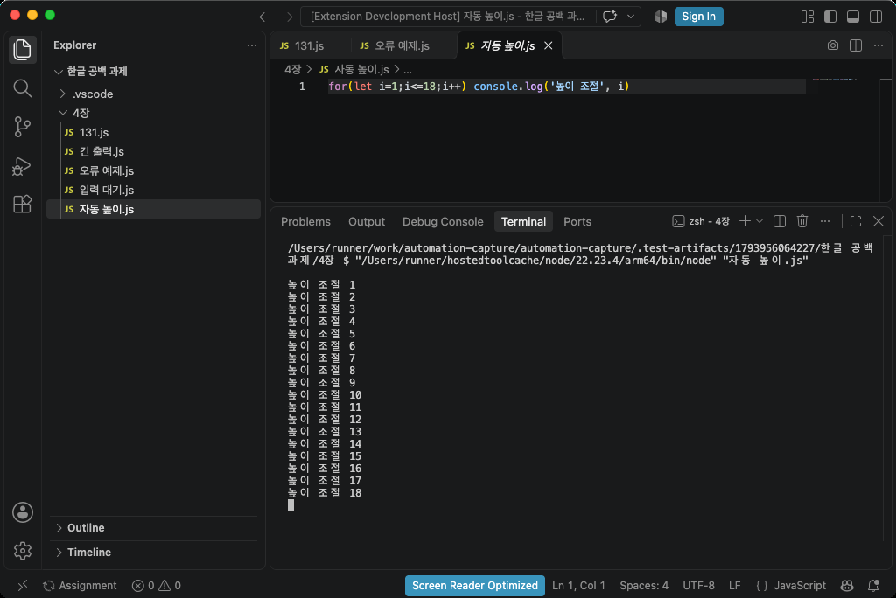
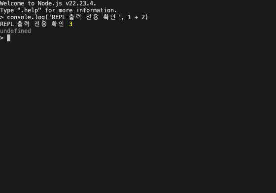

# 개발·상세 설정

[처음 사용하는 분은 설치·실행 안내부터 확인하세요](../README.md).

## 기술 스택

| 영역 | 공통 | Windows 버전 | Mac 버전 |
|---|---|---|---|
| 확장·파일·명령 | TypeScript, VS Code Extension API | 동일 | 동일 |
| JS 실행 | Node.js, child_process, JSON 상태 전달 | 실제 CMD 재사용 | 실제 zsh 재사용 |
| 실제 창 캡처 | Python | mss, PyGetWindow, Win32/DWM | PyObjC, AppKit, Quartz, macOS screencapture |
| 영역 측정·높이 조절 | 출력 행·여백 계산 | comtypes, Windows UI Automation | ApplicationServices AX, Quartz 마우스 이벤트 |
| 이미지·압축 | Pillow, archiver | PNG/JPG/WebP·ZIP | PNG/JPG/WebP·ZIP |
| 빌드·검증 | TypeScript Compiler, @vscode/vsce, node:test, unittest, GitHub Actions | Windows x64 러너 | Apple Silicon·Intel Mac 러너 |

## 소스에서 빌드하기

아래 내용은 소스를 수정하거나 설치 파일을 만드는 개발자용입니다. 일반 사용자는 [Windows](../README.windows.md) 또는 [Mac](../README.macos.md) 안내에서 VSIX만 설치합니다.

```sh
git clone https://github.com/Blaze828/automation-capture.git
cd automation-capture
```

빌드 머신에는 Node.js 22 이상과 Python 3.10 이상이 필요합니다. `uv`로 재배포 가능한 Python과 캡처 패키지를 준비하고, 공식 Node 배포 파일의 SHA-256을 검증해 VSIX에 포함합니다. 사용자 PC에서는 이 빌드 과정을 실행하지 않습니다.

```sh
npm ci
python -m pip install uv==0.13.7
npm run prepare:runtime
npm test
npm run package
```

현재 운영체제·아키텍처에 맞는 파일 하나를 `dist/`에 만듭니다. Windows x64, Mac M시리즈, Mac Intel은 각각 일치하는 CI 러너에서 빌드합니다. `package:windows`, `package:mac`, `package:all`도 현재 컴퓨터에 맞는 패키지만 만듭니다.

Python 검사는 설치에 사용한 Python으로 `-m unittest discover -s test -p 'test_*.py'`를 실행합니다. 실제 VS Code 통합 검사는 `npm run test:integration`이며, `AUTOCAPTURE_API_ONLY=1`은 화면 촬영을 제외한 확장·터미널 API 검사입니다.

Windows Python 검사:

```powershell
& "runtime/bundled/python/python.exe" -E -s -X utf8 -m unittest discover -s test -p 'test_*.py'
```

Mac Python 검사:

```sh
runtime/bundled/python/bin/python3 -E -s -X utf8 -m unittest discover -s test -p 'test_*.py'
```

CI는 완성된 VSIX를 한글·공백 경로에 풀고, 존재하지 않는 사용자 Node/Python 경로와 잘못된 PYTHONHOME/PYTHONPATH, 최소 PATH 상태에서 확장·터미널·실제 GUI를 검사합니다. VS Code 설치 경로가 다르면 `VSCODE_EXECUTABLE`을 지정합니다.

## 설정

VS Code 설정에서 `assignment`를 검색합니다.

| 설정 | 기본값·설명 |
|---|---|
| `assignment.useBundledRuntime` | 기본 `true`. 포함된 Node/Python/캡처 패키지를 사용하므로 별도 설치가 필요 없음 |
| `assignment.pythonPath` | 고급 설정. 위 옵션을 끈 경우 사용할 Python 실행 파일 경로 |
| `assignment.nodePath` | 고급 설정. 위 옵션을 끈 경우 사용할 Node 실행 파일 경로 |
| `assignment.outputFolder` | 제출 루트의 절대 경로. 명령으로 선택 가능 |
| `assignment.imageFormat` | 첫 캡처 때 PNG/JPG/WebP 선택 |
| `assignment.timeoutSeconds` | 30초 |
| `assignment.captureDelayMs` | 800ms |

Node/Python 경로에는 실행 파일만 넣습니다. 폴더 경로나 인수는 넣지 않습니다.

## 화면·출력 처리

- CMD/zsh는 이 확장이 만든 터미널만 재사용합니다. 그 터미널에서 다른 프로그램이 실행 중이면 종료 후 자동 실행을 사용합니다.
- 출력이 들어가면 배치를 유지합니다. 넘칠 때만 실제 영역을 측정해 한 번 높이를 조절하며, 여백은 약 12%, 최소 2~최대 5행입니다.
- 더 늘릴 수 없으면 출력을 분할합니다. 긴 소스는 별도 JS 파일로 제출하므로 자동 코드 분할의 기준이 되지 않습니다.
- 기본 제한 시간까지 반복 출력이 계속되면 중단하고 대표 화면을 저장합니다. 입력 대기나 출력 없는 루프에는 계속 실행·중단·수동 캡처 선택지를 표시합니다.
- 같은 이름의 제출 파일에는 덮어쓰기·새 버전·취소를 선택할 수 있습니다. 장 ZIP에는 장 폴더 바로 아래의 JS와 이미지만 포함합니다.

## 추가 문제 해결

| 증상 | 확인 |
|---|---|
| Python 모듈 오류 | 0.7.0 이상으로 다시 설치하고 `assignment.useBundledRuntime`을 켜세요. 직접 지정한 환경은 옵션을 껐을 때만 사용합니다 |
| 파일명 불일치 | 원본 JS 탭 선택. 사용자 지정 `window.title`에 `${activeEditorShort}` 포함 |
| 창이 가려져 촬영 취소 | 겹친 창·대화상자를 닫고 VS Code를 전면에 배치 |
| JS만 저장되고 이미지가 없음 | 오류 원인을 해결한 뒤 추가 캡처 단축키 W 사용 |
| Mac에서 접근성 영역을 찾지 못함 | 터미널 선택 후 재시도. 필요하면 `code --force-renderer-accessibility`로 시작 |

Mac에서 터미널 경계선을 확인하지 못하면 일반 실행은 배치를 유지하고 출력 분할로 진행합니다. REPL 영역을 확인하지 못할 때는 오류를 표시합니다.

## 지원·검증 범위

Windows와 macOS의 신뢰한 로컬 데스크톱 VS Code 작업 폴더를 사용합니다. Linux, VS Code 웹, WSL/SSH/컨테이너, 별도 외부 터미널 창 촬영은 지원하지 않습니다. 출력 보관 한도는 1,000,000자입니다. 전체 화면 TUI와 복잡한 ANSI 커서 제어는 지원 대상이 아닙니다.

0.7.0 설치 파일의 환경·검사 결과는 [최신 검증 기록](../TESTING.md)을 확인하세요. Mac M시리즈·Intel은 실제 창과 REPL 촬영까지 검사합니다. Windows는 설치 파일의 확장·터미널 API와 실제 CMD 재사용을 검사하며, 0.7.0 Windows GUI 촬영 전체는 별도 재검증 대상입니다. 실제 Retina 장치·혼합 배율/HDR 다중 모니터 등 남은 범위는 [검증 기록](../TESTING.md)을 확인하세요.

<details>
<summary><b>실제 Mac 검증 화면 보기</b></summary>

출력 18줄 전체, 아래 여백, 탐색기 선택 파일과 활성 탭을 한 장에 담았습니다.



REPL은 출력 영역만 저장했습니다.



</details>
